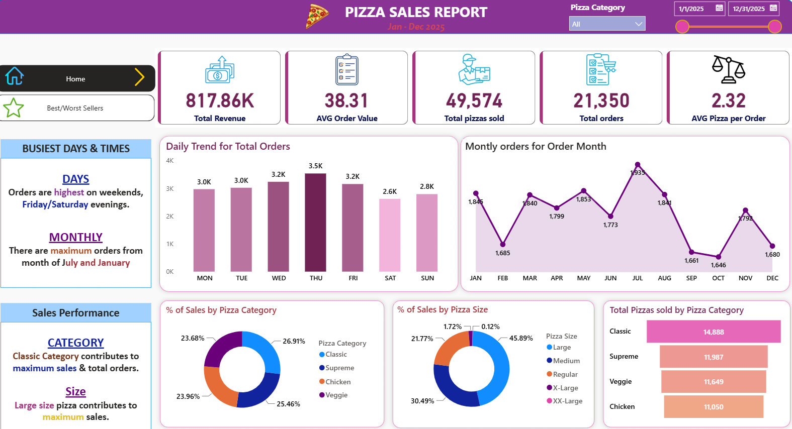
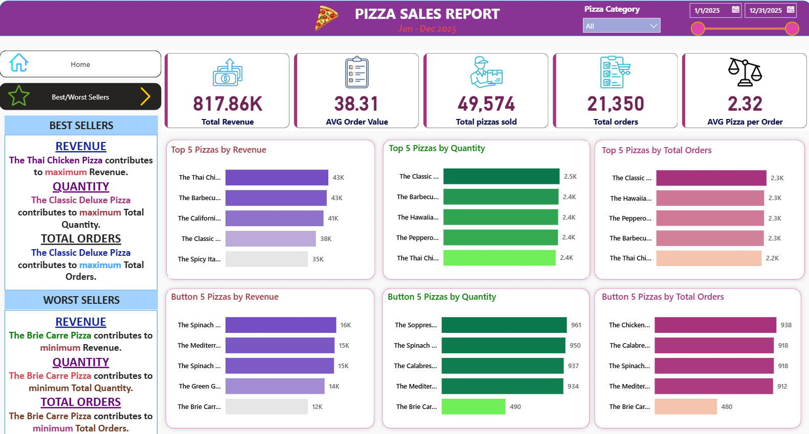

# 🍕 Pizza Sales Analytics Dashboard (Power BI & SQL)

## 📌 Project Overview
This project delivers an end-to-end Business Intelligence solution designed to analyze and monitor the operational performance of a pizzeria throughout the year 2025. The project covers the complete data lifecycle: from importing and querying raw data within a relational database management environment, validating key metrics using custom SQL scripts, to advanced semantic modeling, DAX measure creation, and building a sleek, multi-page interactive Power BI dashboard.

---

## 🖼️ Dashboard Preview

### Page 1: Executive Overview

### Page 2: Product Performance (Best / Worst Sellers)

---

## 🛠️ End-to-End Workflow & Architecture

1. **Database Management & SQL Validation (HeidiSQL):**
   * The raw transactional dataset (`pizza_sales.csv`) was imported into a relational database managed via **HeidiSQL**.
   * Custom SQL queries were written and executed to calculate baseline Key Performance Indicators (KPIs) and validate data integrity prior to visualization. All SQL scripts have been documented for reference.

2. **Data Ingestion & Transformation (Power Query):**
   * Due to corporate environment and software access constraints, direct SQL server connectivity was substituted with a local CSV import workflow.
   * Regional settings were adjusted using Power Query's **"Using Locale: English (United States)"** functionality to parse non-standard date formats (`DD/MM/YYYY` vs `MM/DD/YYYY`), preventing date-parsing errors across system environments.
   * Standardized column data types (Decimal Numbers for pricing, Whole Numbers for quantities, and standard Date/Time types).

3. **Data Modeling & Advanced Metadata (DAX & DMVs):**
   * Engineered core DAX measures to track business performance: **Total Revenue**, **Total Orders**, **Total Pizzas Sold**, **Average Order Value (AOV)**, and **Average Pizzas per Order**.
   * Implemented a conditional sorting column (`Day Number`) to enforce logical chronological progression (Monday through Sunday) for daily trend analysis.
   * **Advanced Model Documentation:** Utilized DAX Dynamic Management Views (`INFO.VIEW.MEASURES()` and `INFO.VIEW.COLUMNS()`) to create dedicated calculated tables that automatically document the semantic model's measures, expressions, and column properties directly inside the report.

---

## 📊 Dashboard Structure (2-Page Layout)

* **Page 1: Home (Executive Overview)**
  * **KPI Cards:** Highlights main business metrics ($817.86K Total Revenue, AOV, Total Pizzas Sold, Total Orders, and Avg Pizzas per Order) styled with custom series-anchored icons.
  * **Time-Series Trends:** Visualizes order volume by Day of the Week (highlighting weekend peak demand) and monthly sales trends across 2025.
  * **Categorical Breakdown:** Displays revenue distribution across Pizza Categories (*Classic, Supreme, Chicken, Veggie*) and Sizes (*Large, Medium, Regular, X-Large, XX-Large*).

* **Page 2: Best / Worst Sellers (Product Performance)**
  * **Top 5 & Bottom 5 Rankings:** Horizontal bar charts identifying top-performing and underperforming pizza items based on **Revenue**, **Quantity Sold**, and **Total Orders**, enabling fast menu optimization insights.

---

## 🚀 Tools & Technologies Used
* **Database Management:** HeidiSQL (SQL Querying & Data Validation)
* **Business Intelligence:** Power BI Desktop
* **Languages & Querying:** DAX (Data Analysis Expressions), SQL, Power Query (M)
* **Design & UI/UX:** "Warm Pizzeria Classic" custom palette (Crimson Red, Warm Amber, Dark Slate, Soft Off-White), card-based container design, and strict visual hierarchy.

---
*Developed as an end-to-end personal data analytics portfolio project.*
